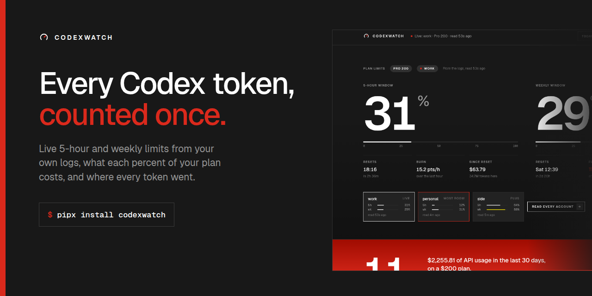
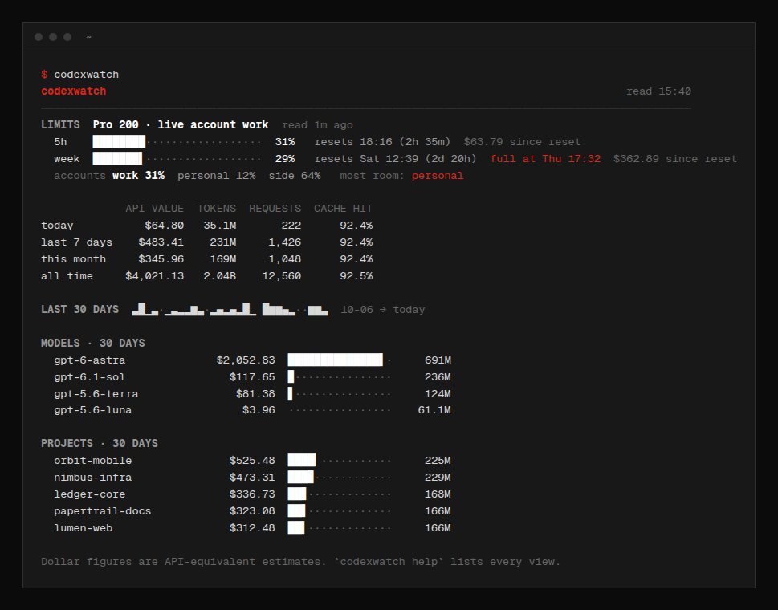
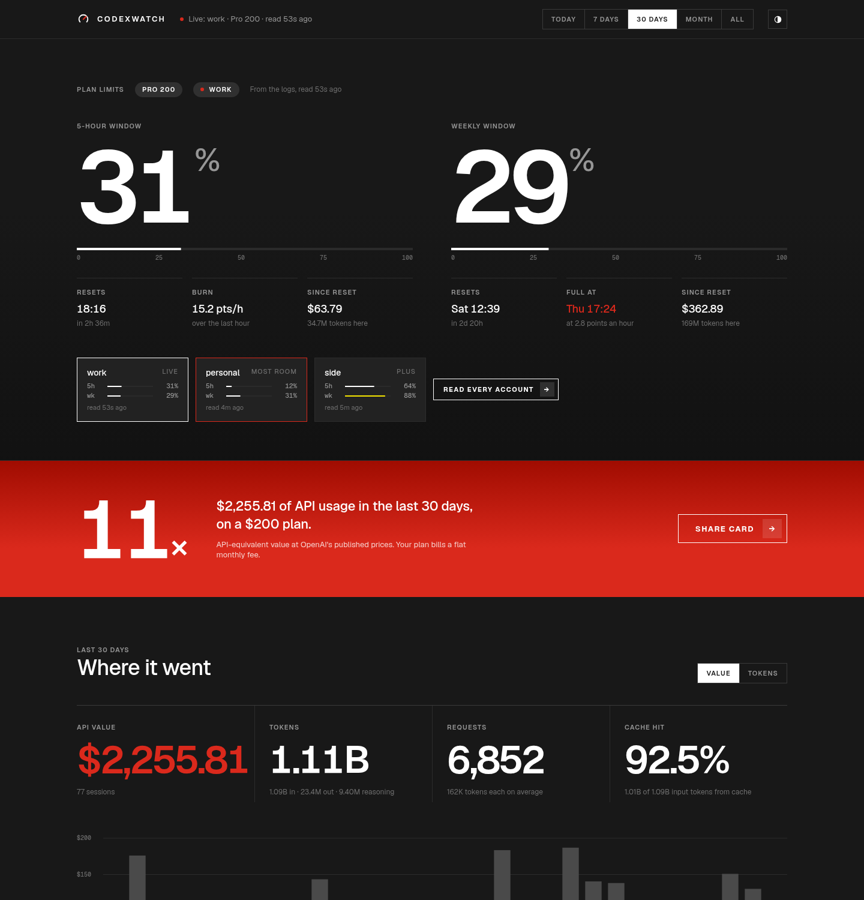
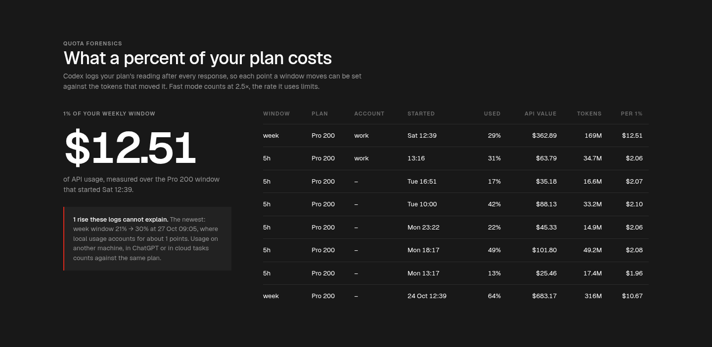
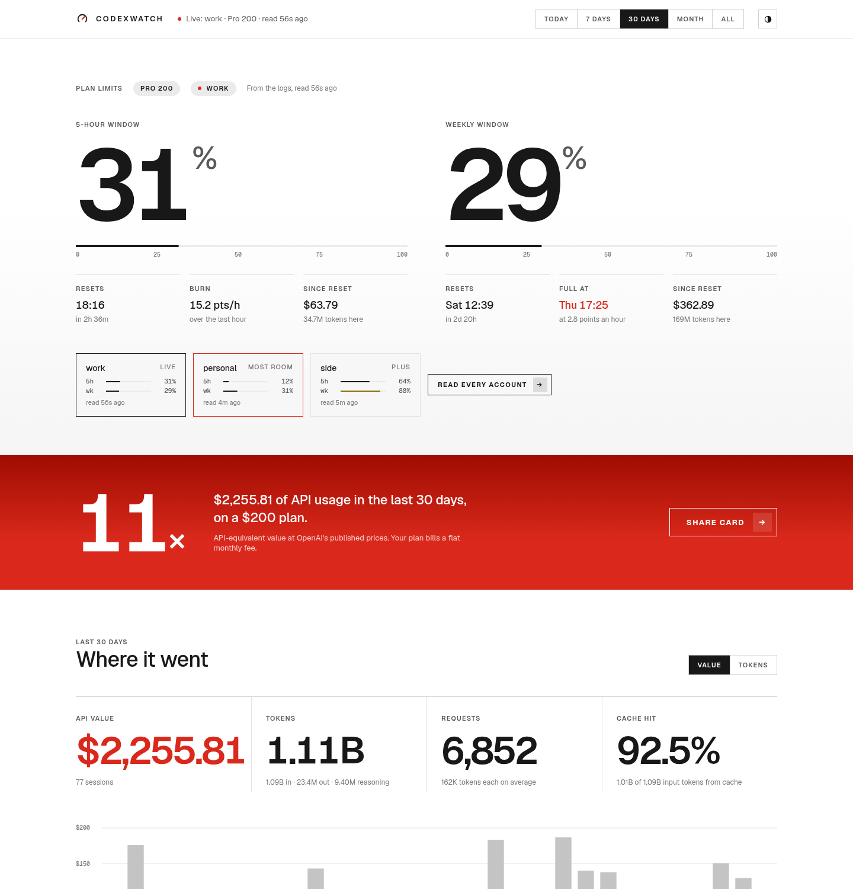
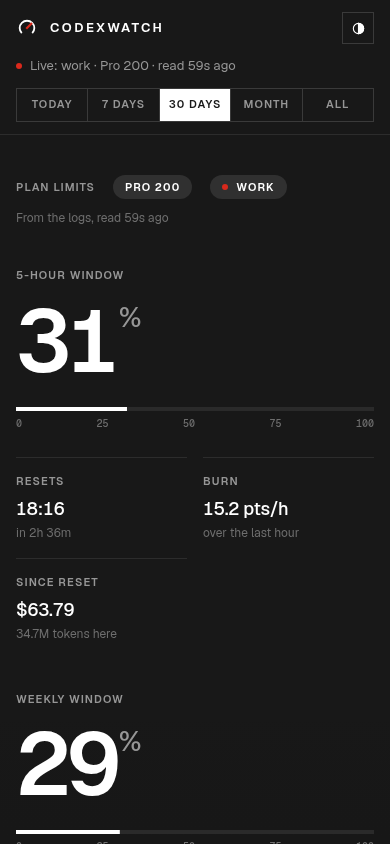
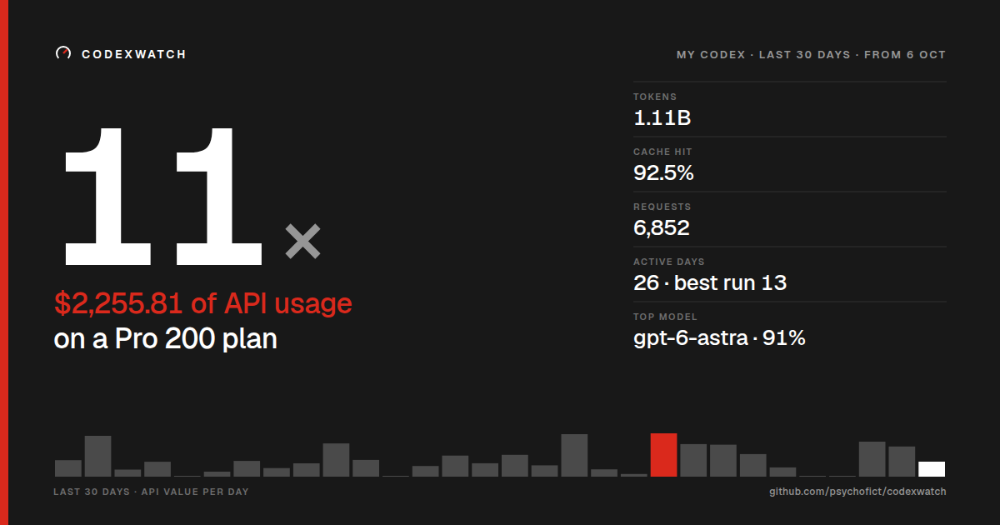

<p align="center">
  
</p>

<p align="center">
  <a href="https://pypi.org/project/codexwatch-cli/"></a>
  <a href="https://github.com/psychofict/codexwatch/actions/workflows/ci.yml"></a>
  <a href="https://github.com/psychofict/codexwatch/blob/main/LICENSE"></a>
  
  
  <a href="https://glama.ai/mcp/servers/psychofict/codexwatch"></a>
  <a href="https://scorecard.dev/viewer/?uri=github.com/psychofict/codexwatch"></a>
</p>

codexwatch shows where your OpenAI Codex usage goes: tokens and their API-equivalent cost per day, project, model, session and tool, your plan's 5-hour and weekly limits as they stand now, and what each percent of those limits cost you. By default it reads only the session logs Codex already writes on your machine, never opens your login, and makes no network request; fetching prices and refreshing codexhop accounts are things you ask for.

```bash
pipx install codexwatch-cli  # or: pip install --user codexwatch-cli
codexwatch                   # the overview in your terminal
codexwatch dashboard         # the web dashboard
```

You need nothing beyond the Codex logs already on this machine, so the first command already has your numbers. On Linux, `./install.sh --tray --desktop` from a clone also adds an app-menu entry, a desktop shortcut and the tray.

<p align="center">
  
</p>

## What it does differently

### Every response is counted once

Codex gives each model response an id. codexwatch keys every row on it, so a forked session that copies its parent's history, a subagent, a repeated token event or the same logs synced from another machine never add tokens twice. Those are the four ways Codex usage has been overcounted, and each one has a test that reproduces it.

### Your plan limits come from your own logs

After every response Codex writes the plan's rate-limit reading into the session log: how full the 5-hour and weekly windows are and when they reset. codexwatch reads those, so the live figures need no network call and no login.

### Quota forensics

Because each reading follows a known response, codexwatch can set the tokens spent in a window against how far the window moved. You get an exchange rate (dollars of API usage per percent of your plan, per window and per day) and a flag on any rise your local logs do not account for, such as usage from another machine or from ChatGPT itself.

### Fast on large logs

Lines are filtered on their first bytes, so tool output and reasoning text are never decoded, and a growing session is read from where the last scan stopped. On the machine it was built on, 1.85 GB of logs in 59 sessions took about 2 seconds to scan the first time (measured, 2026-11-04); later scans read only new lines.

### Prices you can check

Every bundled price was copied from OpenAI's pricing pages, with the date and the page. A model with no published price is shown as unpriced and left out of dollar totals, never counted as $0. Fast mode is priced at the Fast tier, and prompts over 272K tokens at the long-context rate.

## The dashboard

`codexwatch dashboard` opens a page on `127.0.0.1`. It works offline, follows your system's light or dark setting, and refreshes as you work.

<p align="center">
  
</p>

The top of the page is your plan: both windows with their reset times, the burn rate over the last hour, the time the window fills at that pace, and what you have spent since it reset. The red band below compares the last 30 days of usage with what your plan costs. After that come the totals for the period you pick, a daily chart, models and projects, quota forensics, recent sessions, a weekday-by-hour map, tool calls, and how your work ran (CLI, IDE or `codex exec`, Standard or Fast, main sessions or subagents).

<p align="center">
  
</p>

<details>
<summary>Light theme and phone</summary>
<p align="center">
  
  
</p>
</details>

## Share card

`codexwatch card` writes a 1200 × 630 image of your month, and the dashboard's Share card button saves it as SVG or PNG. It leads with what your plan returned. Project names stay off the card unless you pass `--projects`, because a project name can be a client's name.

<p align="center">
  
</p>

Plan prices come from OpenAI's Codex pricing page. Enterprise and Edu have no public price, so set yours with `codexwatch config set plan_price 60`.

## In your menu bar, tray, status bar and prompt

`codexwatch bar -f FORMAT` prints one line, or a small menu, in the shape each bar expects. It reads only new log lines, so calling it every few seconds is cheap.

| Where | How |
|---|---|
| macOS menu bar | Install [SwiftBar](https://github.com/swiftbar/SwiftBar) or xbar, then copy [`extras/swiftbar/codexwatch.30s.sh`](extras/swiftbar/codexwatch.30s.sh) into its plugin folder (or run `./install.sh --swiftbar`). |
| Linux tray | `codexwatch tray`, or `./install.sh --tray` to start it now and at every login (`--desktop` also puts a shortcut on the desktop). A ring shows the 5-hour window; the menu holds both windows, today's value and your codexhop accounts. It uses your distribution's GTK bindings (`python3-gi` and an AppIndicator package), even when codexwatch itself was installed with pipx. |
| waybar | `"custom/codex": {"exec": "codexwatch bar -f waybar", "return-type": "json", "interval": 30}` |
| tmux | `set -g status-right '#(codexwatch bar -f tmux)'` |
| polybar, i3blocks | `-f polybar`, `-f i3blocks` |
| Shell prompt | `PS1='$(codexwatch bar -f prompt --no-scan) \$ '` |

Desktop notifications fire as a window passes 75%, 90% and 100%, once each per window. The tray sends them, or run `codexwatch notify` from a timer.

## Ask about it from Codex or Claude

`codexwatch mcp` is an MCP server, so an agent can check your usage mid-session:

```bash
codex mcp add codexwatch -- codexwatch mcp     # OpenAI Codex
claude mcp add codexwatch -- codexwatch mcp    # Claude Code
```

Then ask "how much of my 5-hour window is left?" or "what did this week cost?". The tools are `usage_summary`, `plan_limits`, `quota_forensics`, `sessions`, `daily` and `budget_status`. The server is in the official [MCP Registry](https://registry.modelcontextprotocol.io/) as `io.github.psychofict/codexwatch`.

<a href="https://glama.ai/mcp/servers/psychofict/codexwatch"></a>
<a href="https://mcprush.com/psychofict/codexwatch-mcp"></a>

<!-- mcp-name: io.github.psychofict/codexwatch -->

## Several ChatGPT accounts

[codexhop](https://github.com/psychofict/codexhop) keeps several ChatGPT logins for Codex and switches between them. When it is installed, codexwatch shows every account's latest reading and the one with the most room, names the account behind each plan window in the quota report, and `codexwatch limits --refresh` asks codexhop for fresh readings of all of them. codexhop can also hop to a provider such as Azure or Bedrock; codexwatch lists those beside the accounts, marks the one codexhop has hopped to as live, and never offers one as the account with room, because a provider has no plan limits. codexwatch itself never opens a login file; it runs `codexhop` for anything that needs one.

`codexwatch autohop` moves Codex to another of your saved accounts when the live one is nearly spent. It is for accounts that are yours, such as a personal plan and your own seat in a company workspace, never a login someone shared with you; each account keeps its own limits, and OpenAI's terms of use apply to each one. It is off until you run it, and without `--apply` it only says what it would do:

```text
$ codexwatch autohop
15:41:56  stay  work is at 31% of its 5-hour window and 29% weekly; below 92% / 97%, so stay
```

With `--apply` it hops when the live account reaches 92% of its 5-hour window or 97% of its week, only to an account with at least 25% of its 5-hour window free, and at most once every 20 minutes. Every number can be changed in the `autohop` block of `config.json`. [`extras/systemd`](extras/systemd) runs it every 3 minutes, and creating a file called `autohop.off` in the codexwatch folder stops it.

## Budgets

```bash
codexwatch budget add --name "Monthly" --usd 300 --every month
codexwatch budget add --name "atlas daily" --usd 20 --every day --scope project:atlas-api
codexwatch budget add --name "5h headroom" --pct 80 --window 5h
codexwatch budget list
```

A dollar or token budget adds up API-equivalent usage over the local calendar day, week (from Monday) or month, for everything or one project or model. A percent budget watches the plan's own window. Each sends a notification at 80% of its limit (`--notify-pct`) and again when it is spent. `codexwatch budget check` exits 1 when any budget is over, for scripts and CI.

## Several machines

Copy or sync another machine's `~/.codex` (or just its `sessions` folder) somewhere and add it:

```bash
codexwatch sources add ~/sync/laptop-codex --machine laptop
codexwatch machines
```

Responses that appear in both places are counted once, by their response id.

## Commands

Every report takes `-p/--period` (`today`, `7d`, `30d`, `week`, `month`, `year`, `all`, `2026-10`, `2026-10-31`), `--since` and `--until`, filters (`--project`, `--model`, `--client`, `--machine`, `--account`) and `--json`.

| Command | What it shows |
|---|---|
| `codexwatch` | Plan limits, totals for today, 7 days, this month and all time, a 30-day strip, top models and projects |
| `daily`, `weekly`, `monthly` | Tokens (input, cached, output, reasoning) and API value per period; `--csv` |
| `projects`, `models`, `clients`, `machines`, `tiers`, `efforts`, `agents` | The same, grouped another way |
| `sessions` | Recent sessions with title, model, turns, tokens, value and compactions; subagents under their parent |
| `tools` | Which tools Codex called and how often |
| `latency` | Median and 90th-percentile turn time and time to first token, per model |
| `hours` | A weekday-by-hour map of when you use Codex |
| `limits` | Every plan window, burn rate, when it fills, and codexhop accounts; `--refresh` |
| `quota` | Dollars per percent of each window and day, and rises the logs cannot explain |
| `live` | A full-screen view that redraws every few seconds |
| `dashboard` | The web dashboard on `127.0.0.1:7878` |
| `card` | The share card; `--projects`, `--theme light`, `--plan-price` |
| `bar` | One line for a status bar or prompt |
| `tray` | The Linux tray icon |
| `budget` | `add`, `list`, `rm`, `check` |
| `notify` | Send any due notification once |
| `autohop` | Move to another of your own codexhop accounts when the live one is nearly spent (dry run unless `--apply`) |
| `mcp` | The MCP server |
| `demo` | The dashboard on invented data; `--terminal` for the overview |
| `export` | Every response as CSV or JSON |
| `prices` | The price list; `update` pulls LiteLLM's, `path` shows where your overrides go |
| `sources` | `add` or `rm` another machine's logs |
| `scan` | Read new log lines now; `--full` re-reads everything |
| `config`, `doctor`, `reprice` | Settings, a setup check, and re-costing after a price change |

## How the numbers are made

Dollar figures are what the same tokens would cost on the OpenAI API at the published Standard price. ChatGPT plans bill a flat fee, so treat them as a measure of how much you used, not a bill. Input tokens include cached and cache-written tokens, and output tokens include reasoning, as in OpenAI's usage object.

The plan figures come from the readings in your logs, so they are as fresh as your last Codex request on this machine. Usage on another machine, in ChatGPT or in cloud tasks counts against the same plan but reaches these logs only with your next request here; that is what the quota report's "rises these logs cannot explain" catches. Fast mode spends plan limits at 2.5 times the Standard rate, and the quota report weights it that way.

[docs/how-it-works.md](docs/how-it-works.md) covers the log format, every counting rule and the forensics in detail.

## Prices

The bundled list covers the models Codex has used, from gpt-5 and o3 to gpt-6-astra, as of 2026-11-04. `codexwatch prices` lists them with their source. To change one, put it in `prices.json` in the codexwatch folder (`codexwatch prices path`):

```json
{"models": {"gpt-6-astra": {"input": 10.0, "cached": 1.0, "cache_write": 12.5, "output": 50.0}}}
```

Prices are USD per million tokens. `codexwatch prices update` downloads LiteLLM's list to fill gaps; your own file still wins, and `codexwatch reprice` re-costs your history after any change.

## Privacy

codexwatch reads `~/.codex/sessions` (and `archived_sessions`) and writes only to its own folder: `~/.config/codexwatch` on Linux, `~/Library/Application Support/codexwatch` on macOS, `%APPDATA%\codexwatch` on Windows. It makes no network request unless you run `prices update`, or ask codexhop for readings with `limits --refresh`, the dashboard's button or `autohop`. The dashboard listens on `127.0.0.1` only and answers data requests only from its own page, with a token a web page elsewhere cannot read. [SECURITY.md](SECURITY.md) has the details.

## Platforms

| | Linux | macOS | Windows |
|---|:---:|:---:|:---:|
| CLI, live view, dashboard, card, MCP, budgets | yes | yes | yes |
| Menu bar or tray | tray (GTK) | SwiftBar or xbar | no |
| Autohop (needs codexhop) | yes | yes | no |

Python 3.9 or newer; no packages beyond the standard library.

## FAQ

**Why is the package called codexwatch-cli?** PyPI treats `codexwatch` as the same name as an unrelated project called `codex-watch`, so the package carries a suffix. The command is `codexwatch`, and `codexwatch-cli` works too. To run it once without installing: `uvx codexwatch-cli`.

**Why do my dollar figures differ from another tool's?** Most often because that tool counted forked sessions, subagents or repeated events twice, priced fast mode at the Standard rate, or treated a model with no price as $0. `codexwatch doctor` lists unpriced models, and `export` gives you every response to check against.

**Does it work with Codex in VS Code, `codex exec` and the desktop app?** Yes, they all write the same logs; `codexwatch clients` splits usage by where it ran. Codex cloud tasks do not write local logs, so they appear only through their effect on your plan windows.

**I use an API key, not a ChatGPT plan.** Then there are no plan windows, and the dollar figures are close to your actual bill.

**Can I try it without Codex logs?** `codexwatch demo` opens the dashboard on two months of invented usage, kept apart from your real history.

## Contributing

Issues and pull requests are welcome. [CONTRIBUTING.md](CONTRIBUTING.md) explains how to run the tests (`python -m pytest`) and how to add a log format or a price.

codexwatch is built by [Ebenworks](https://ebenworks.co/), which also makes [codexhop](https://github.com/psychofict/codexhop) and [claudehop](https://github.com/psychofict/claudehop), and, with Statotech Systems, the [Claude Usage Widget & Token Tracker](https://github.com/StaticB1/claude_ai_usage_widget). The dashboard uses the [Geist](https://github.com/vercel/geist-font) fonts under the SIL Open Font License.

MIT licence. Not affiliated with, endorsed by, or sponsored by OpenAI. "OpenAI", "Codex" and "ChatGPT" are trademarks of OpenAI, used here only to say what this works with.
